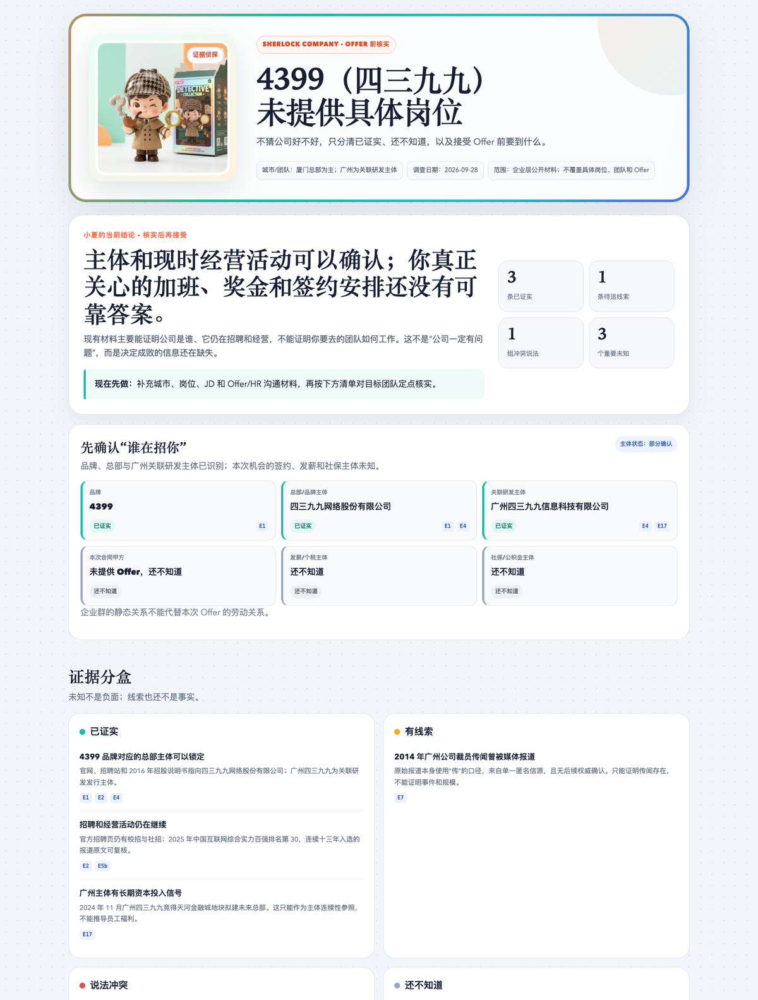
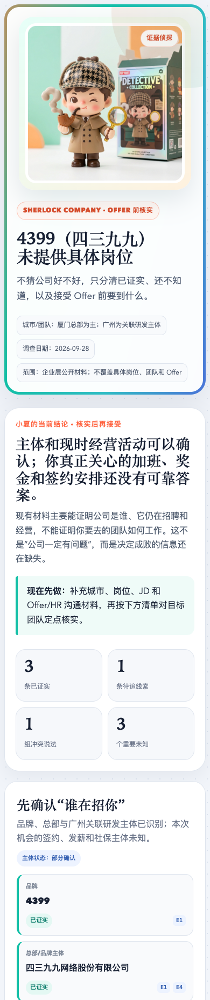

# Sherlock Company｜入职前查公司、员工评价与 Offer 核验 Skill

**Offer 前的公司证据调查助手。** 输入公司、岗位、城市和你最关心的问题，它会把网上的各种说法整理成四种状态——已证实 / 有线索 / 说法冲突 / 还不知道——并给你一份接受 Offer 前的核实清单，和一份可以离线打开的 HTML「侦探档案」。

想核实加班、奖金或团队管理，可以从公开资料查起，也可以让它通过 Tabbit 阅读你已登录的脉脉页面。它会区分招聘宣传、亲历自述和二手转述，告诉你哪些说法有依据、哪些仍需向目标团队核实。

> [!TIP]
> 🎁 扫码关注公众号「欧八同学」，免费领取 AI 案例与 Skill《大厂产品AI经验编程 200 套》→ [去扫码](#author)

[使用示例](#quick-example) · [开始使用](#quick-start) · [English](#english-overview)

<a id="quick-example"></a>

## 一次使用示例

**虚构输入：**「我准备接受某公司的产品经理 Offer，城市是杭州。请先核实签约主体，重点查奖金口径、试用期和加班安排。」

**输出：** 每个关切分别列出已证实内容、线索、冲突与未知，以及下一步应核实的问题；Skill 路径还能生成离线 HTML 档案。没有找到证据时保留“还不知道”。

先看 [公开案例与证据链](cases/4399/)，或按 [快速开始](#quick-start) 选择 Skill／通用 Prompt。示例请求不代表对这家虚构公司的调查结论。

## 报告长什么样

| 桌面版 | 手机版 |
| :---: | :---: |
|  |  |

这是 4399 案例报告的开屏部分（结论、主体识别、证据分类）。完整报告和证据链在 [cases/4399/](./cases/4399/)，下载仓库后，用浏览器打开 HTML 即可离线阅读；GitHub 文件页展示的是源码。调查和生成过程仍需要联网工具与模型。

## 它怎么工作

1. **先锁定签约主体。** 品牌 ≠ 签约公司：「字节跳动」的劳动合同甲方可能是集团内任何一家子公司。主体没确认前，不下公司结论。
2. **按关切检索，建立证据账本。** 用公司别名、城市、岗位与具体问题寻找原文及评论，区分亲历、面经、内推宣传与二手汇编，合并同源转载。搜索摘要和匿名体验默认是线索；原文可读也不等于内容真实。
3. **每条断言只落四种状态。** 已证实 / 有线索 / 说法冲突 / 还不知道。「页面被拦截」「搜到 0 条」是检索状态，不是「不存在问题」。
4. **主动找反证。** 对每个关键疑点写「观察 → 假设 → 支持与反证 → 当前判断」，负面材料分清匿名指控、进行中争议和已确认结果。
5. **产出报告。** 一句话结论、逐条关切卡片（已知 / 未知 / 影响 / 下一步）、可复制给招聘人员的核实问题清单，以及离线 HTML 档案。

<a id="quick-start"></a>

## 快速开始

### 方式一：安装 Skill（本地智能体）

先下载仓库，再把 `skill/sherlock-company` 复制到智能体的技能目录（以 Codex 为例；已下载仓库可跳过前两行）：

```bash
git clone https://github.com/ouxxyy/sherlock-company.git
cd sherlock-company
mkdir -p "${CODEX_HOME:-$HOME/.codex}/skills/sherlock-company"
cp -R skill/sherlock-company/. "${CODEX_HOME:-$HOME/.codex}/skills/sherlock-company/"
```

重启或重新加载智能体后：

```text
使用 $sherlock-company 调查「公司 + 岗位 + 城市」。我最关心加班、试用期、奖金和签约主体。
```

Skill 需要智能体具备联网搜索和文件读写能力；生成 HTML 报告需要本机有 Python 3。

### 方式二：不装任何东西

把 [PROMPT.md](./PROMPT.md) 里的通用 Prompt 复制给任意联网 AI，填入公司、岗位、城市和你的关切。它会按同样的规则产出文字报告，不依赖本仓库的脚本。

## 样例案例

仓库里带三个只用公开信息跑出来的实测样例：

| 案例 | 输入 | 报告 |
| --- | --- | --- |
| 4399 | `4399` | [report-v5.html](./cases/4399/report-v5.html)，含完整证据链（输入、主体关系、来源登记、证据账本、反证、复评） |
| 字节跳动 | `字节跳动 后端开发 北京` | [report.html](./cases/bytedance-backend-bj/report.html) |
| 拼多多 | `拼多多 后端开发 上海` | [report.html](./cases/pdd-backend-sh/report.html) |

三个案例的结论都落在四档状态之一（如「核实后再接受」），不自动生成星级或百分比评分。

## 员工评价与登录态搜索

想查员工评价，可以直接这样说：

```text
使用 $sherlock-company 调查「公司名 + 城市 + 岗位」。
重点查实际下班时间、奖金兑现和试用期。
公开资料不够时，用 Tabbit 搜索我已登录的脉脉，阅读相关正文和评论。
把亲历、提问、招聘宣传和 AI 汇总分开，说明哪些适用于目标团队。
```

这是调用格式示例，不对应任何公司的调查结论。Tabbit 是可选工具，需要在你的智能体环境中可用；登录和验证码由你在浏览器完成。未安装、未登录或页面无法读取时，仍可继续公开调查。

| 信息来源 | 用来查什么 | 使用边界 |
| --- | --- | --- |
| 脉脉职言、点评和评论 | 工作强度、奖金、管理及项目经历 | 登录增加可见内容，不保证评价真实；匿名经历仍需核验 |
| 牛客讨论与面经 | 校招、面试、录用比较及入职体验 | 提问和内推宣传不能当作员工亲历 |
| 看准、知乎、V2EX 等候选渠道 | 补充具体经历、追溯原始出处 | 按目标选择，不承诺每个平台都可访问 |
| 官网、官方公示与可靠媒体 | 招聘承诺、主体、经营和争议记录 | 不替代目标团队的实际体验 |

海外评价只用于匹配地区，小红书仅处理你提供或历史本地的材料。登录态原文、账号信息和未脱敏截图不提交公共仓库。

**已实测：** 2026-10-24，在 Apple M1 Mac 上通过 Tabbit 读到了登录后的脉脉搜索结果、职言正文和可见评论，也进入了“看点评”信息流；公开检索读到了牛客体验正文。**尚未验证：** 公司专属点评聚合页、全部评论覆盖，以及匿名作者身份。具体过程见 [搜索能力审计](research/search-audit-2026-10-24.md)。

## 企查查（可选）

Skill 默认从公开网络检索开始，需要时补可用的登录态阅读。如果你配置了[企查查智能体数据平台](https://agent.qcc.com/)的官方 MCP 或 CLI，它会用企查查核对法律主体、工商、股东、经营风险和司法记录；出现多个候选主体时会先请你确认，而不是替你猜：

```bash
npm install -g qcc-agent-cli
```

API Key 在平台右上角头像 →「获取我的 API KEY」申请。密钥不要写进命令行参数、截图或提交记录；官方服务协议要求账号与数据在中国大陆境内使用。接入方式、积分计费和权限边界见 [research/qcc-official.md](./research/qcc-official.md)。

## 生成 HTML 报告

调查结束后，Skill 会把结构化案件记录渲染成自包含的离线 HTML——侦探形象已内嵌，打开不需要 CDN、字体或 JavaScript：

```bash
python3 skill/sherlock-company/scripts/render_report.py \
  cases/4399/decision-report.json \
  --output cases/4399/report-v5.html
```

JSON 格式见 [case-schema.md](./skill/sherlock-company/references/case-schema.md)。渲染器会转义外部文字、拒绝不安全协议链接、扫描个人联系方式，未完成隐私复核的案件会被拒绝渲染。

## 开发者：测试与视觉验收

```bash
python3 -m unittest discover -s tests -v   # 18 项渲染逻辑与安全测试
npm install --no-save playwright           # 可选：离线渲染视觉回归
node tests/verify_generated_html.mjs       # 缺省回归 4399，可传其它案例目录名
```

报告视觉风格的三版迭代样张见 [index.html](./index.html)（选版中心）及 version1–3 三个页面，仅作视觉参考，不是可执行模板。

## 边界与限制

- 结论默认只在「可以继续聊 / 核实后再接受 / 已足够决定 / 先不接受」中选一个，紧跟证据理由；不生成星级或「信息完整度 xx%」，除非你明确要求并定义了评分模型。
- 员工体验拿不到时，报告会如实写缺口和补证路线，不编造体验评分或样本量。
- 不做账号池、反爬绕过或评价平台爬虫，纯公开搜索有时间上限。
- 分析你的职位说明、录用通知或聊天记录前，会先要求脱敏（手机号、证件号、银行卡、签名等）；未获明确授权不会把这些材料发给外部服务。
- 已验证环境：Apple M1 Mac、Python 3、Chrome/Playwright；企查查 MCP 完成过握手与一次真实主体识别。其它环境未实测。

## 常见问题

### 能直接判断这家公司值不值得去吗？

报告帮助核实关切和证据边界，不把未经证实的信息压成一个公司评分。

### 搜不到负面材料能证明没有风险吗？

不能。搜到 0 条、页面被拦或只有匿名说法都不能证明不存在问题。

### 必须购买企查查服务吗？

不必须。企查查是可选补充，相关调用按该服务积分计费；公开检索仍需联网能力。

### 通用 Prompt 也会生成 HTML 吗？

通用 Prompt 主要输出文字报告。Skill 的 HTML 交付还需要文件读写和本机 Python 3。

<a id="english-overview"></a>

## English overview

A pre-offer employer research Skill that separates confirmed findings, leads, conflicts and unknowns. Give it the employer, role, city and your concerns; it produces verification questions and, through the Skill workflow, an offline HTML case file.

Optional Tabbit browsing can read accessible Maimai discussions and comments in your own signed-in session. Anonymous reviews remain leads, and access to every platform or company review page is not guaranteed.

Start with [Quick start](#quick-start) or the [public case files](cases/4399/). Research requires web access; HTML rendering requires Python 3. Qichacha is optional and may charge credits. Missing search results and anonymous claims are not proof of an employer's conduct.

## 相关项目

[欧八同学的 AI Skills 与跳槽涨薪工具合集](https://github.com/ouxxyy/ouba-classmate)，还可以接着使用：

- [整理有来源证据的岗位](https://github.com/ouxxyy/job-search)
- [准备经历面试](https://github.com/ouxxyy/ai-interviewer)
- 全部项目与作者主页：[github.com/ouxxyy](https://github.com/ouxxyy)

<a id="author"></a>

## 作者

作者全平台同名：**欧八同学**。

联系我：[albertou.redboook.cn](https://albertou.redboook.cn/)

- 微信公众号：扫码关注，免费领取 AI 案例与 Skill《大厂产品AI经验编程 200 套》
- 抖音：[搜索“欧八同学”](https://www.douyin.com/search/%E6%AC%A7%E5%85%AB%E5%90%8C%E5%AD%A6)
- 小红书：[搜索“欧八同学”](https://www.xiaohongshu.com/search_result?keyword=%E6%AC%A7%E5%85%AB%E5%90%8C%E5%AD%A6)
- X：[搜索“欧八同学”](https://x.com/search?q=%E6%AC%A7%E5%85%AB%E5%90%8C%E5%AD%A6&src=typed_query)

<p align="center">
  
</p>

<p align="center"><sub>扫码关注「欧八同学」，免费领取《大厂产品AI经验编程 200 套》</sub></p>

如果这个项目对你有用，欢迎点个 Star。遇到问题时，提交命令、报错和最小复现步骤就够了；请不要上传真实私人照片。

## 许可证

[MIT](./LICENSE)。仓库中的侦探形象为 AI 生成的原创虚构形象；调查方法借鉴了 [sherlock-project/Sherlock](https://github.com/sherlock-project/Sherlock)（MIT）的工程思路，未复制其代码。
