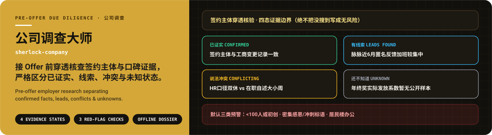
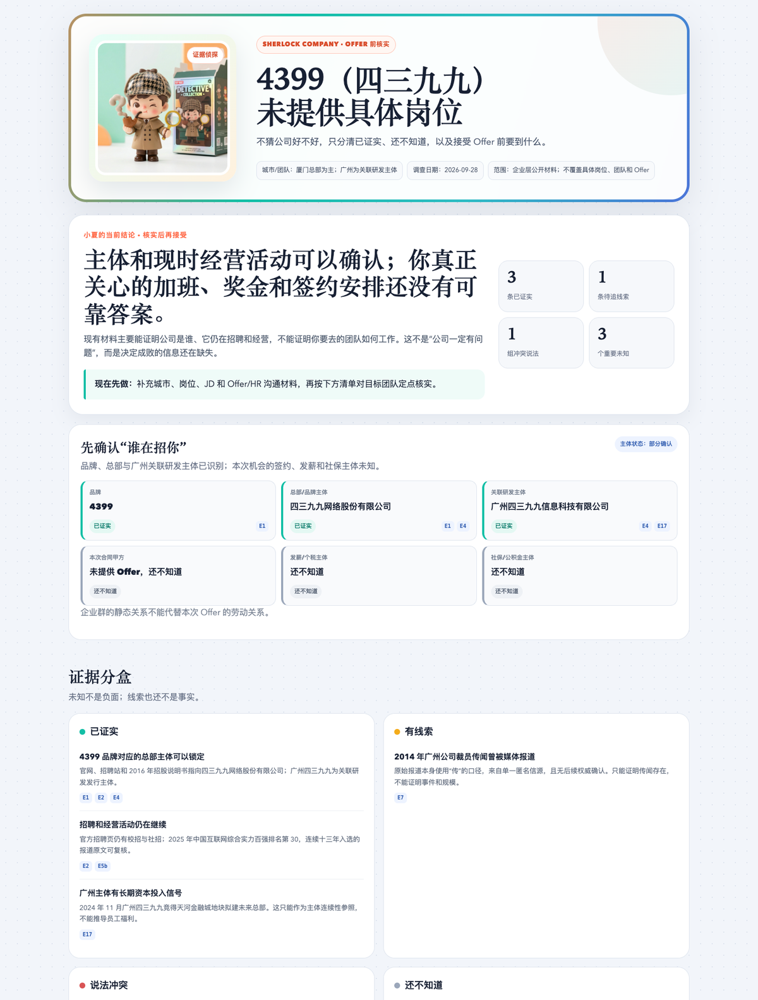
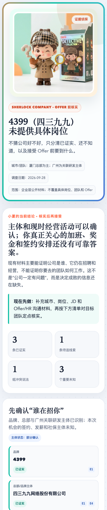

# 公司调查大师（sherlock-company）｜入职前查公司、员工评价与 Offer 核验 Skill

<!-- hero:start -->

<p>
  <a href="https://github.com/ouxxyy/ouba-classmate"></a>
</p>

**接 Offer 前先给公司做一轮福尔摩斯式体检，按「已证实 / 有线索 / 说法冲突 / 还不知道」四态证据分层整理公开情报与离线 HTML 背调档案。**  
<sub>Pre-offer company due-diligence dossier grading public evidence into verified, clue, conflicting, and unknown states with an offline HTML report.</sub>

<p>
  <a href="https://github.com/ouxxyy/ouba-classmate"></a>
  <a href="#quick-example"></a>
  <a href="#quick-start"></a>
  <a href="#english-overview"></a>
  <a href="https://github.com/ouxxyy"></a>
</p>

> 🌟 本项目是 [欧八同学旗舰合集 `ouba-classmate`](https://github.com/ouxxyy/ouba-classmate) 的核心组件（11 个原创项目，可[一键安装全部 Skills](https://github.com/ouxxyy/ouba-classmate#install)）。如果它帮到了你，欢迎顺手给 [旗舰主仓库](https://github.com/ouxxyy/ouba-classmate) 点个 Star ⭐ 支持持续更新 ｜ 终端 1 秒加星：`gh api -X PUT /user/starred/ouxxyy/ouba-classmate`


<!-- hero:end -->

**Offer 前的公司证据调查助手。** 输入公司、岗位、城市和你最关心的问题，它会把网上的各种说法整理成四种状态——已证实 / 有线索 / 说法冲突 / 还不知道——并给你一份接受 Offer 前的核实清单，和一份可以离线打开的 HTML「侦探档案」。

想核实加班、奖金或团队管理，可以从公开资料查起，也可以让它通过 Tabbit 阅读你已登录的脉脉页面。它会区分招聘宣传、亲历自述和二手转述，告诉你哪些说法有依据、哪些仍需向目标团队核实。

每次调查还会主动检查三类预警：**公司少于 100 人或属于初创公司、密集的感恩或业绩冲刺标语、居民楼办公**。有依据就提醒，证据不充分则标为待核实，并给出可向招聘人员追问的问题。

> [!TIP]
> 🎁 扫码关注公众号「欧八同学」，免费领取 AI 案例与 Skill《大厂产品AI经验编程 200 套》→ [去扫码](#author)

[使用示例](#quick-example) · [开始使用](#quick-start) · [English](#english-overview)

<a id="quick-example"></a>

## 一次使用示例

**虚构输入：**「我准备接受某公司的产品经理 Offer，城市是杭州。请先核实签约主体，重点查奖金口径、试用期和加班安排。」

**输出：** 每个关切分别列出已证实内容、线索、冲突与未知，以及下一步应核实的问题；Skill 路径还能生成离线 HTML 档案。没有找到证据时保留“还不知道”。

先看 [公开案例与证据链](cases/4399/)，或按 [快速开始](#quick-start) 选择 Skill／通用 Prompt。示例请求不代表对这家虚构公司的调查结论。

## 报告长什么样

| 桌面版 | 手机版 |
| :---: | :---: |
|  |  |

这是 4399 案例报告的开屏部分（结论、主体识别、证据分类）。完整报告和证据链在 [cases/4399/](./cases/4399/)，下载仓库后，用浏览器打开 HTML 即可离线阅读；GitHub 文件页展示的是源码。调查和生成过程仍需要联网工具与模型。

## 它怎么工作

1. **先锁定签约主体。** 品牌 ≠ 签约公司：「字节跳动」的劳动合同甲方可能是集团内任何一家子公司。主体没确认前，不下公司结论。
2. **按关切检索，建立证据账本。** 用公司别名、城市、岗位与具体问题寻找原文及评论，区分亲历、面经、内推宣传与二手汇编，合并同源转载。搜索摘要和匿名体验默认是线索；原文可读也不等于内容真实。
3. **每条断言只落四种状态。** 已证实 / 有线索 / 说法冲突 / 还不知道。「页面被拦截」「搜到 0 条」是检索状态，不是「不存在问题」。
4. **主动找反证。** 对每个关键疑点写「观察 → 假设 → 支持与反证 → 当前判断」，负面材料分清匿名指控、进行中争议和已确认结果。
5. **产出报告。** 一句话结论、三类默认预警检查、逐条关切卡片（已知 / 未知 / 影响 / 下一步）、可复制给招聘人员的核实问题清单，以及离线 HTML 档案。

## 三类默认预警

| 检查项 | 何时提醒 | 还会核实什么 |
| --- | --- | --- |
| 规模与初创 | 公司少于 100 人，**或**当前属于初创公司，任一满足即提醒 | 实际人数、主体与统计日期、当前业务阶段、岗位和薪酬安排；参保人数不等于员工总数，恰好 100 人不因人数触发 |
| 感恩与业绩标语 | 办公环境或公司材料中密集、反复出现“感恩公司/老板”“冲刺××”“军令状”等内容 | 原话、位置、时间和活动背景，以及绩效、工时和未达标处理；单句价值观或同图转载不能证明“很多” |
| 居民楼办公 | 实际办公室位于住宅单元；仅注册地址为居民楼时，也会提示实际办公地待核实 | 注册地、面试地和日常工作地的区别，楼宇/单元用途与搬迁情况；商住楼中的商业办公单元不能直接算住宅办公 |

这三类会进入开头提醒、关切卡片和接受录用前的核实清单。证据不足时写“待核实预警”；完全没有材料时保留未知，不写“已排除风险”。预警不自动得出“不值得入职”，也不证明公司违法或管理有问题。完整判断规则见 [公司默认预警检查](./skill/sherlock-company/references/company-warnings.md)。

<a id="quick-start"></a>

## 快速开始

### 方式一：安装 Skill（本地智能体）

先下载仓库，再把 `skill/sherlock-company` 复制到智能体的技能目录（以 Codex 为例；已下载仓库可跳过前两行）：

```bash
git clone https://github.com/ouxxyy/sherlock-company.git
cd sherlock-company
mkdir -p "${CODEX_HOME:-$HOME/.codex}/skills/sherlock-company"
cp -R skill/sherlock-company/. "${CODEX_HOME:-$HOME/.codex}/skills/sherlock-company/"
```

重启或重新加载智能体后：

```text
使用 $sherlock-company 调查「公司 + 岗位 + 城市」。我最关心加班、试用期、奖金和签约主体。
```

Skill 需要智能体具备联网搜索和文件读写能力；生成 HTML 报告需要本机有 Python 3。

### 方式二：不装任何东西

把 [PROMPT.md](./PROMPT.md) 里的通用 Prompt 复制给任意联网 AI，填入公司、岗位、城市和你的关切。它会按同样的规则产出文字报告，不依赖本仓库的脚本。

## 样例案例

仓库里带三个只用公开信息跑出来的实测样例：

| 案例 | 输入 | 报告 |
| --- | --- | --- |
| 4399 | `4399` | [report-v5.html](./cases/4399/report-v5.html)，含完整证据链（输入、主体关系、来源登记、证据账本、反证、复评） |
| 字节跳动 | `字节跳动 后端开发 北京` | [report.html](./cases/bytedance-backend-bj/report.html) |
| 拼多多 | `拼多多 后端开发 上海` | [report.html](./cases/pdd-backend-sh/report.html) |

三个案例的结论都落在四档状态之一（如「核实后再接受」），不自动生成星级或百分比评分。

这些历史案例尚未按新增的三类预警规则补查，供查看报告形式与原有证据链；不把旧报告当作已完成新检查的结果。

## 员工评价与登录态搜索

想查员工评价，可以直接这样说：

```text
使用 $sherlock-company 调查「公司名 + 城市 + 岗位」。
重点查实际下班时间、奖金兑现和试用期。
公开资料不够时，用 Tabbit 搜索我已登录的脉脉，阅读相关正文和评论。
把亲历、提问、招聘宣传和 AI 汇总分开，说明哪些适用于目标团队。
```

这是调用格式示例，不对应任何公司的调查结论。Tabbit 是可选工具，需要在你的智能体环境中可用；登录和验证码由你在浏览器完成。未安装、未登录或页面无法读取时，仍可继续公开调查。

| 信息来源 | 用来查什么 | 使用边界 |
| --- | --- | --- |
| 脉脉职言、点评和评论 | 工作强度、奖金、管理及项目经历 | 登录增加可见内容，不保证评价真实；匿名经历仍需核验 |
| 牛客讨论与面经 | 校招、面试、录用比较及入职体验 | 提问和内推宣传不能当作员工亲历 |
| 看准、知乎、V2EX 等候选渠道 | 补充具体经历、追溯原始出处 | 按目标选择，不承诺每个平台都可访问 |
| 官网、官方公示与可靠媒体 | 招聘承诺、主体、经营和争议记录 | 不替代目标团队的实际体验 |

海外评价只用于匹配地区，小红书仅处理你提供或历史本地的材料。登录态原文、账号信息和未脱敏截图不提交公共仓库。

**已实测：** 2026-10-24，在 Apple M1 Mac 上通过 Tabbit 读到了登录后的脉脉搜索结果、职言正文和可见评论，也进入了“看点评”信息流；公开检索读到了牛客体验正文。**尚未验证：** 公司专属点评聚合页、全部评论覆盖，以及匿名作者身份。具体过程见 [搜索能力审计](research/search-audit-2026-10-24.md)。

## 企查查（可选）

Skill 默认从公开网络检索开始，需要时补可用的登录态阅读。如果你配置了[企查查智能体数据平台](https://agent.qcc.com/)的官方 MCP 或 CLI，它会用企查查核对法律主体、工商、股东、经营风险和司法记录；出现多个候选主体时会先请你确认，而不是替你猜：

```bash
npm install -g qcc-agent-cli
```

API Key 在平台右上角头像 →「获取我的 API KEY」申请。密钥不要写进命令行参数、截图或提交记录；官方服务协议要求账号与数据在中国大陆境内使用。接入方式、积分计费和权限边界见 [research/qcc-official.md](./research/qcc-official.md)。

## 生成 HTML 报告

调查结束后，Skill 会把结构化案件记录渲染成自包含的离线 HTML——侦探形象已内嵌，打开不需要 CDN、字体或 JavaScript：

```bash
python3 skill/sherlock-company/scripts/render_report.py \
  cases/4399/decision-report.json \
  --output cases/4399/report-v5.html
```

JSON 格式见 [case-schema.md](./skill/sherlock-company/references/case-schema.md)。渲染器会转义外部文字、拒绝不安全协议链接、扫描个人联系方式，未完成隐私复核的案件会被拒绝渲染。

## 开发者：测试与视觉验收

```bash
python3 -m unittest discover -s tests -v   # 18 项渲染逻辑与安全测试
npm install --no-save playwright           # 可选：离线渲染视觉回归
node tests/verify_generated_html.mjs       # 缺省回归 4399，可传其它案例目录名
```

报告视觉风格的三版迭代样张见 [index.html](./index.html)（选版中心）及 version1–3 三个页面，仅作视觉参考，不是可执行模板。

## 边界与限制

- 结论默认只在「可以继续聊 / 核实后再接受 / 已足够决定 / 先不接受」中选一个，紧跟证据理由；不生成星级或「信息完整度 xx%」，除非你明确要求并定义了评分模型。
- 员工体验拿不到时，报告会如实写缺口和补证路线，不编造体验评分或样本量。
- 不做账号池、反爬绕过或评价平台爬虫，纯公开搜索有时间上限。
- 分析你的职位说明、录用通知或聊天记录前，会先要求脱敏（手机号、证件号、银行卡、签名等）；未获明确授权不会把这些材料发给外部服务。
- 已验证环境：Apple M1 Mac、Python 3、Chrome/Playwright；企查查 MCP 完成过握手与一次真实主体识别。其它环境未实测。

## 常见问题

### 能直接判断这家公司值不值得去吗？

报告帮助核实关切和证据边界，不把未经证实的信息压成一个公司评分。

### 搜不到负面材料能证明没有风险吗？

不能。搜到 0 条、页面被拦或只有匿名说法都不能证明不存在问题。

### 必须购买企查查服务吗？

不必须。企查查是可选补充，相关调用按该服务积分计费；公开检索仍需联网能力。

### 通用 Prompt 也会生成 HTML 吗？

通用 Prompt 主要输出文字报告。Skill 的 HTML 交付还需要文件读写和本机 Python 3。

<a id="english-overview"></a>

## English overview

A pre-offer employer research Skill that separates confirmed findings, leads, conflicts and unknowns. Give it the employer, role, city and your concerns; it produces verification questions and, through the Skill workflow, an offline HTML case file.

Optional Tabbit browsing can read accessible Maimai discussions and comments in your own signed-in session. Anonymous reviews remain leads, and access to every platform or company review page is not guaranteed.

Every new investigation checks for companies with fewer than 100 employees or at the startup stage, dense gratitude/performance-pressure slogans, and residential workplaces. Warnings retain their evidence limits and lead to verification questions; they do not automatically mean rejecting an offer.

Start with [Quick start](#quick-start) or the [public case files](cases/4399/). Research requires web access; HTML rendering requires Python 3. Qichacha is optional and may charge credits. Missing search results and anonymous claims are not proof of an employer's conduct.

<!-- suite-matrix:start -->

## 更多开源项目 · More from ouba-classmate Suite

> 如果这个项目帮到了你，欢迎去旗舰合集仓 [**`ouxxyy/ouba-classmate`**](https://github.com/ouxxyy/ouba-classmate) 点一颗 Star 或一行安装全部 Skills：
> `npx skills add ouxxyy/ouba-classmate` · `gh api -X PUT /user/starred/ouxxyy/ouba-classmate`

| 仓库 · Repo | 分类 · Category | 它做什么 · What it does |
| --- | --- | --- |
| [`ouba-classmate`](https://github.com/ouxxyy/ouba-classmate) | SUITE · 旗舰合集 | **11 个原创项目总仓 + 一键安装全部 Skills + 在线战力测算与防身情报库**<br><sub>All-in-one Skills suite & benchmark</sub> |
| [`jd-resume-match`](https://github.com/ouxxyy/jd-resume-match) | CAREER · 求职涨薪 | **AI 简历优化与 JD 匹配体检（确定性公式 + 行号证据）**<br><sub>Deterministic JD matching & line-cited resume audit</sub> |
| [`ai-interviewer`](https://github.com/ouxxyy/ai-interviewer) | CAREER · 求职涨薪 | **中文语音/文字原话追问 AI 模拟面试官（含在线版）**<br><sub>Chinese voice AI mock interviewer anchored to your answers</sub> |
| [`job-search`](https://github.com/ouxxyy/job-search) | CAREER · 求职涨薪 | **跨 5 平台实时去重筛岗，输出带来源短名单**<br><sub>5-platform source-backed job search & shortlist builder</sub> |
| [`sherlock-company`](https://github.com/ouxxyy/sherlock-company) · **Current** | CAREER · 求职涨薪 | **入职前四态证据公司背调与 Offer 核实清单**<br><sub>Pre-offer employer research with 4-state evidence boundaries</sub> |
| [`mbai`](https://github.com/ouxxyy/mbai) | CAREER · 求职涨薪 | **工作任务 AI 不可替代指数与 4 核决策复盘**<br><sub>Task-level AI irreplaceability index & decision reflection</sub> |
| [`codex-gif-video`](https://github.com/ouxxyy/codex-gif-video) | CREATIVE · AI 创作 | **69 种风格原生 GIF 与静音 MP4 素材生成 Skill**<br><sub>Native GPT Image 2.6 animated GIF & MP4 generator (69 styles)</sub> |
| [`storyboard-scavenger`](https://github.com/ouxxyy/storyboard-scavenger) | CREATIVE · AI 创作 | **可灵/即梦/Veo/Sora 七要素 AI 视频分镜工作流**<br><sub>7-element AI video storyboard skill for Kling & Seedance</sub> |
| [`travel-art-album-skill`](https://github.com/ouxxyy/travel-art-album-skill) | CREATIVE · AI 创作 | **旅行照片艺术画册与单文件离线翻页相册 Skill**<br><sub>Art-styled travel photo proofs & standalone offline HTML flipbook</sub> |
| [`mystery-skill`](https://github.com/ouxxyy/mystery-skill) | COGNITION · 认知框架 | **Mystery 认知框架与职场心理博弈分析 Skill**<br><sub>Cognitive framework for interview frame & decision study</sub> |
| [`Attention`](https://github.com/ouxxyy/Attention) | LOCAL APP · 本地工具 | **ActivityWatch 本地专注力、心流时段与切换分析**<br><sub>Local ActivityWatch focus & context-switching dashboard</sub> |
| [`postapp`](https://github.com/ouxxyy/postapp) | LOCAL APP · 本地工具 | **Chrome 本地摄像头姿态检测与坐姿提醒插件**<br><sub>On-device MoveNet Chrome posture reminder extension</sub> |

<!-- suite-matrix:end -->

<a id="author"></a>

## 作者

作者全平台同名：**欧八同学**。

联系我：[albertou.redboook.cn](https://albertou.redboook.cn/)

- 微信公众号：扫码关注，免费领取 AI 案例与 Skill《大厂产品AI经验编程 200 套》
- 抖音：[搜索“欧八同学”](https://www.douyin.com/search/%E6%AC%A7%E5%85%AB%E5%90%8C%E5%AD%A6)
- 小红书：[搜索“欧八同学”](https://www.xiaohongshu.com/search_result?keyword=%E6%AC%A7%E5%85%AB%E5%90%8C%E5%AD%A6)
- X：[搜索“欧八同学”](https://x.com/search?q=%E6%AC%A7%E5%85%AB%E5%90%8C%E5%AD%A6&src=typed_query)

<p align="center">
  
</p>

<p align="center"><sub>扫码关注「欧八同学」，免费领取《大厂产品AI经验编程 200 套》</sub></p>

如果这个项目对你有用，欢迎点个 Star。遇到问题时，提交命令、报错和最小复现步骤就够了；请不要上传真实私人照片。

## 许可证

[MIT](./LICENSE)。仓库中的侦探形象为 AI 生成的原创虚构形象；调查方法借鉴了 [sherlock-project/Sherlock](https://github.com/sherlock-project/Sherlock)（MIT）的工程思路，未复制其代码。

<!-- footer:start -->

<p align="center">
  <a href="https://github.com/ouxxyy"></a>
</p>

<!-- footer:end -->
